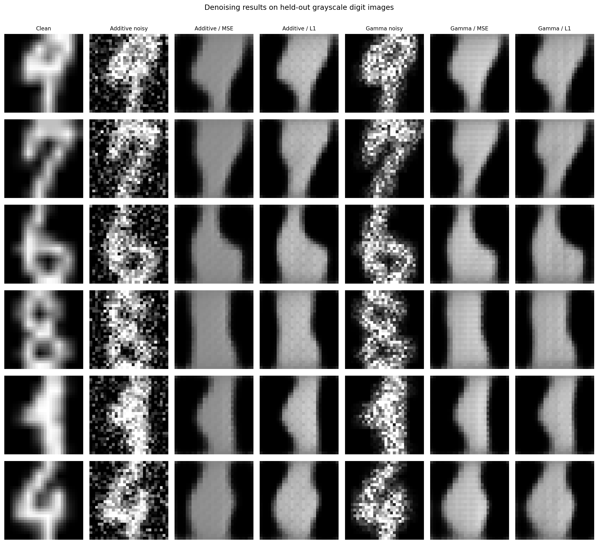
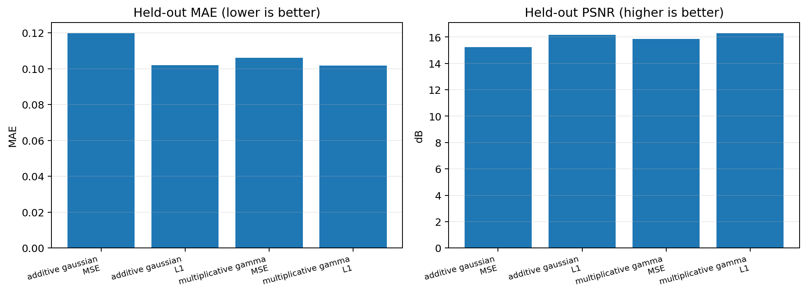
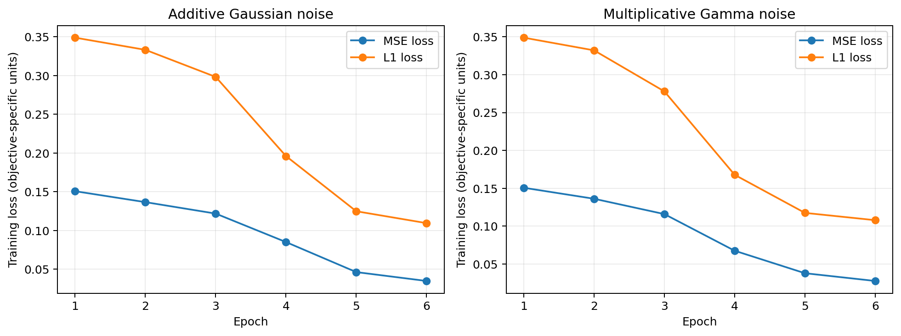

# Denoising Autoencoder in PyTorch

A small, reproducible research-style project comparing reconstruction losses for image denoising under two synthetic noise models. It was built as a practical introduction to the implementation and evaluation work involved in self-supervised learning research.

> **Scope note:** this is a grayscale-digit denoising exercise, not a SAR-processing method. The multiplicative Gamma perturbation is only *speckle-inspired*; it is not a physically faithful SAR simulator and the results should not be generalized to Sentinel-1 imagery.

## Research question

How does the choice of reconstruction objective (mean squared error, MSE, versus mean absolute error, L1) affect denoising performance when the corruption is additive Gaussian noise or simplified multiplicative Gamma noise?

## Experimental design

The experiment is a small 2 × 2 comparison:

| Factor | Conditions |
|---|---|
| Input corruption | Additive Gaussian; multiplicative Gamma |
| Training objective | MSE; L1 |
| Model | Same small convolutional autoencoder architecture |
| Evaluation | Held-out clean images with a fixed corrupted version reused for MSE/L1 within each noise condition |
| Metrics | MSE, MAE and PSNR, all computed on images normalized to [0, 1] |

The default dataset is `sklearn.datasets.load_digits`, a public dataset of 1,797 grayscale 8×8 handwritten-digit images included with scikit-learn. Pixel values are normalized and bilinearly resized to 28×28 for this model. The fixed-seed run below used 1,200 training images, 350 held-out test images and six epochs per condition. The labels are not used for training.

There is also an optional MNIST loader (`--dataset mnist`). It downloads MNIST on first use, so it requires network access. The default Digits mode is offline-ready once the dependencies are installed.

### Noise definitions

- **Additive Gaussian:** `clip(x + sigma * epsilon, 0, 1)`, where `epsilon ~ Normal(0, 1)` and `sigma = 0.25` by default.
- **Multiplicative Gamma:** `clip(x * s, 0, 1)`, where `s ~ Gamma(L, rate=L)` so the factor has mean 1; `L = 4` by default.

The clipping is part of the toy image setup. These corruptions do not represent all the statistics, acquisition geometry, temporal structure or processing steps of SAR imagery.

## Results from the included run

Run settings: `digits`, seed `42`, 1,200 train images, 350 test images, six epochs, batch size 128, CPU. The exact results are saved in [`results/metrics.csv`](results/metrics.csv); plots and checkpoints are included.

| Noise condition | Training loss | MSE (input → output) | MAE (input → output) | PSNR (input → output, dB) |
|---|---:|---:|---:|---:|
| Additive Gaussian | MSE | 0.04035 → 0.03002 | 0.14361 → 0.11966 | 13.94 → 15.23 |
| Additive Gaussian | L1 | 0.04035 → **0.02411** | 0.14361 → **0.10200** | 13.94 → **16.18** |
| Multiplicative Gamma | MSE | 0.02707 → 0.02596 | 0.09595 → 0.10595 | 15.68 → 15.86 |
| Multiplicative Gamma | L1 | 0.02707 → **0.02355** | 0.09595 → 0.10176 | 15.68 → **16.28** |

**Interpretation:** on this run, both models improve MAE and PSNR for additive Gaussian noise, and the L1-trained model gives the best reported metrics. Under the multiplicative Gamma condition, PSNR improves slightly, but MAE becomes worse for both models. This is a useful negative result: a model does not necessarily improve every metric or corruption type after a short training run. The noise conditions also have different effective severity after clipping, so their absolute metrics should not be compared as though the inputs had been severity-matched.

### Figures

**Qualitative reconstructions**



**Held-out metrics**



**Training objective curves**



## Setup

Python 3.10+ is recommended. From the project root:

```bash
python -m venv .venv
source .venv/bin/activate        # Linux/macOS
# .venv\\Scripts\\activate     # Windows PowerShell
python -m pip install --upgrade pip
pip install -r requirements.txt
```

Run the included experiment configuration:

```bash
python -m src.train --dataset digits --epochs 6 --train-limit 1200 --test-limit 350 --seed 42
```

For a larger MNIST experiment on a machine with internet access:

```bash
python -m src.train --dataset mnist --epochs 10 --train-limit 10000 --test-limit 2000 --seed 42
```

Use `--train-limit 0 --test-limit 0` to use all available images. If CUDA is available, it is used automatically; pass `--cpu` to force CPU execution. Training writes the CSV files, JSON metadata, plots and model checkpoints under `results/`.

Run the unit tests:

```bash
python -m pytest -q
```

## Repository structure

```text
.
├── src/
│   ├── data.py        # Digits and optional MNIST loaders
│   ├── metrics.py     # MSE, MAE and PSNR
│   ├── model.py       # Convolutional denoising autoencoder
│   ├── noise.py       # Additive and multiplicative noise
│   └── train.py       # Four-condition experiment and artifact generation
├── tests/
│   └── test_components.py
├── results/
│   ├── figures/       # Reconstruction, metric and training plots
│   ├── models/        # Four trained checkpoints
│   ├── metrics.csv
│   ├── run_metadata.json
│   └── training_history.csv
├── EXPERIMENT_REPORT.md
├── requirements.txt
└── LICENSE
```

## Limitations and next steps

- The source Digits images are only 8×8 pixels; resizing them to 28×28 does not add real spatial detail.
- Results use one random seed, a small subset and six epochs. Repeat with several seeds, a larger dataset and longer training before drawing general conclusions.
- The multiplicative Gamma process is illustrative, not a validated model of SAR intensity statistics. Real SAR work would require suitable SAR time-series data, domain-aware preprocessing and evaluation.
- The objective used for training differs from some reporting metrics, so the metrics are reported separately rather than treating training loss as a universal quality measure.
- This code does not implement self-supervised representation learning, contrastive learning, temporal modeling or SAR-specific augmentations; it is a prerequisite exercise on denoising and controlled evaluation.

Potential follow-up work: repeat the experiment on MNIST; run multiple seeds and report mean ± standard deviation; inspect residual images; and, only after understanding the statistical assumptions, explore an actual SAR dataset and domain-appropriate losses.

## License

MIT. See [`LICENSE`](LICENSE).
